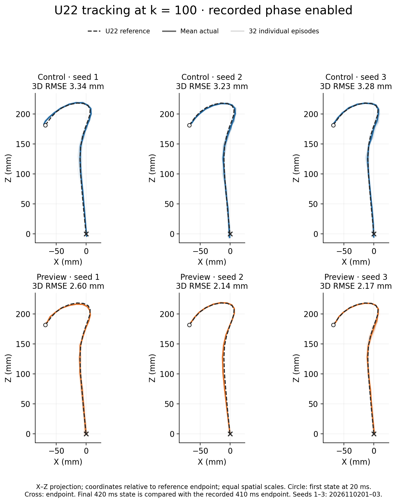
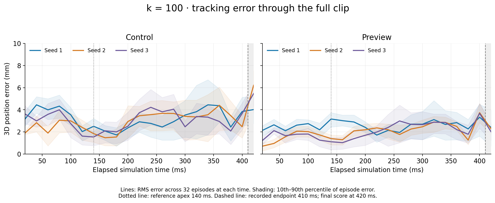
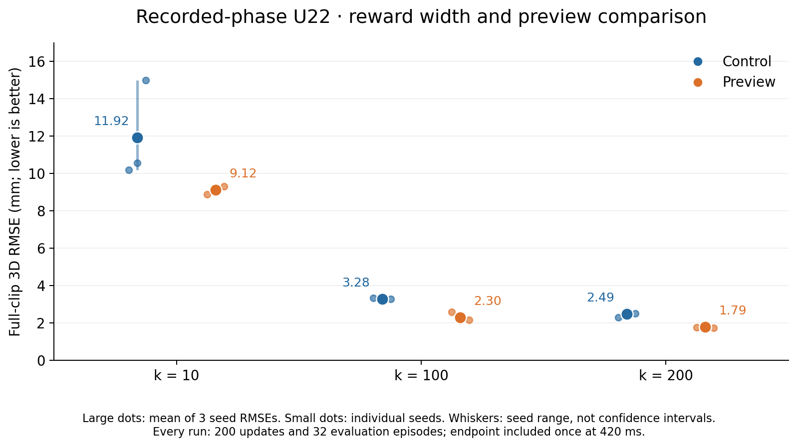

# Frozen U22 recorded-time tracking baseline

This is the tracking-only baseline for subsequent impulse experiments. The
recording lasts 410 ms; the policy runs 21 controls at 20 ms and scores the
clamped endpoint once at 420 ms. No post-contact extension is part of this
baseline. The historical inherited contact-plus-200-ms termination and 5 s
cap remain configured, but reference exhaustion ended all 576 final evaluations.

## Optimized objective and inputs

The sole optimized reward is `0.5 * 0.02 * exp(-k * sum(error_m**2))` per step.
The wrapper replaces the inherited manager reward and forces effective CaT
delta to zero. Joint-load/velocity observers remain present; these results do
not establish constrained strike performance.

Control receives current hammer-head target error. Preview additionally receives
relative target vectors at 20, 40, 80 and 160 ms in actor and critic. Recorded
phase is enabled: `remainder(elapsed / recording_duration, 1)`, scaled as
`2*phase-1` outside learned normalization. Actor/critic widths are 44/48 for
control and 56/60 for preview. Other coordinates use separate empirical
normalizers, epsilon 0.01, updated each environment step.

The action/controller recipe is inherited B: 13 policy outputs, including six
joint-position and six variable-gain outputs. Fixed timing describes reference
timing; it does not mean fixed impedance. No physics changes were made for
this tracking comparison.

## Completed production

Array `50583990`: 18 runs, 200 updates, 1,024 worlds each. Coefficients 10, 100,
200; control/preview; seeds 2026110201, 2026110202, 2026110203. Each final model
was evaluated in 32 worlds. All 18 jobs and evaluations completed successfully.
The failed quota-limited array `50569392` is excluded from the results below.

| k | Control mean full-clip RMSE (mm) | Preview mean (mm) |
|---:|---:|---:|
|10|11.918|9.119|
|100|3.285|2.304|
|200|2.489|1.790|

Means are across the three seed-level RMSEs. Preview beat its matched control
in every seed. k=100 is the selected working baseline; k=200 had the lowest
measured tracking error. Physical strike J50 is censored by the 420 ms cutoff:
the k=100 contacts start at 402.75–413 ms, leaving only 7–17.25 ms after contact.
A zero productive flag here does not establish a physically unproductive hit.





## Frozen source and verification

The production source was a previously frozen dependency bundle plus the timed
runner and phase-test overlays. The dirty development worktree was not the
production source. `source-files.sha256` identifies the 172 runtime/reference,
entry-point, test and launcher files frozen here. Dependencies were inventoried
from a one-update CPU execution and matched against the preserved bundle's
file hashes. The 32 sibling asset files also match the frozen bundle.

Verification: 150 required reward/constraint/phase tests passed, plus a fresh
four-world CPU smoke, checkpoint reload, and evaluation of a saved production
checkpoint. Original Vega preflight and all 18 rollout checks passed before
training. CPU checks validate execution/accounting; they do not assert bitwise
CPU/GPU trajectory agreement. Package versions and receipts are recorded in
`verification.json`. The original GPU runtime archive SHA is retained in the
historical manifest; this Git commit does not bundle that binary environment.

Run from the checkout root, with the required sibling
`safe_impact_manipulation/hammer_z1_env/assets` installed and the recorded
runtime dependencies available:

```sh
python -m scripts.z1_u22_timed_pair --arm preview --seed-index 0 \
  --coefficient 100 --recorded-phase --smoke --worlds 4 --output NEW_DIRECTORY
python -m scripts.z1_u22_timed_pair --arm preview --seed-index 0 \
  --coefficient 100 --evaluate MODEL_199_PT --worlds 32 --output NEW_EVAL_DIRECTORY
```

These examples execute work; they are not authorization for new experiments.
Evaluation follows the checkpoint's saved phase/preprocessing mode. Reference
duration, cutoff, reward and finite-horizon metadata must match the checkpoint.

## Artifact preservation

- `evaluation-results.json`: all 18 final summaries.
- `checkpoint-artifact-index.json`: SHA-256 for all 18 final checkpoints,
  objectives, reset receipts and raw evaluations, plus their backup archive.
- `asset-artifact-index.json`: frozen sibling asset hashes and backup archive.
- `vega-launch-manifest.json`: original deployment hashes and staging provenance.
  Its login-node `/tmp` paths are historical locations, not durable guarantees.
- Final checkpoints and evaluations remain under
  `/ceph/hpc/home/eunikhilr/z1-checks/u22-width-k10-100-200-W118mp/k{10,100,200}/{control,preview}-{0,1,2}/`.
- A second verified copy of the completed-run archive and frozen assets is kept
  locally in `.superpowers/sdd/2026-11-20-z1-baseline-freeze/`. The local artifact
  directory is ignored by Git; model binaries are not part of this commit.
- The six k=100 evaluation traces are bundled beside the plotting script.
  `python figures/make_plots.py` regenerates the three PNG/PDF figure pairs.

The historical tracking score covers the original 21 transitions through
420 ms. Moving/descent scores exclude the later 420 ms sample; endpoint error
scores that sample separately. Any extended evaluation should retain these
prefix metrics and label its post-420-ms continuation separately.

## Why extending termination can add reward

Tracking is evaluated every step; it is not a one-time trajectory-completion
payment. The reference reader clamps to the last recorded position. Therefore,
if the same term is evaluated at 440, 460, 480 and 500 ms, it rewards proximity
to that endpoint four more times. The maximum return would rise from 0.21 to
0.25. A future experiment may instead stop tracking reward after the original
endpoint payment. That is an explicit objective choice on the impulse branch.
