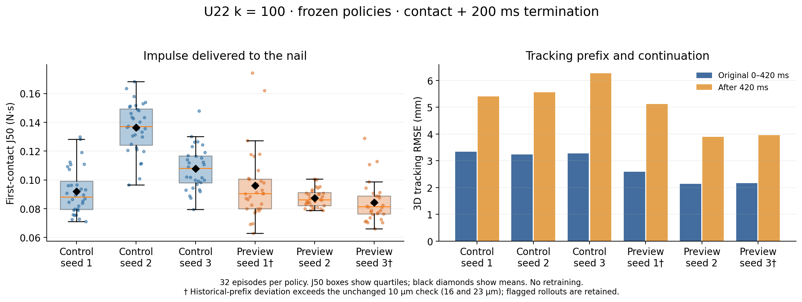
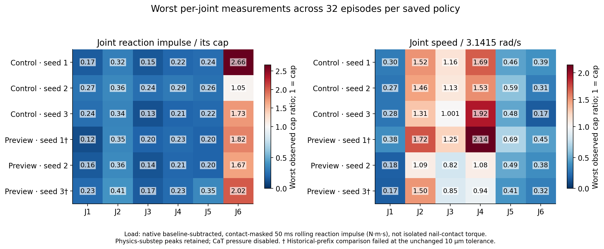

# Six frozen k=100 U22 policies, contact+200ms evaluation

All six saved policies completed 32 first episodes each on Vega (192 total).
There was no retraining. All six canonical checkpoint hashes were unchanged
before and after evaluation. Every episode reached its contact-relative ending
at 620 ms and completed the first-contact 50 ms impulse window.

The original training objective remains the 420 ms tracking-only objective.
`--termination contact` is an explicitly identified evaluation override. Policy
weights, normalization, recorded 410 ms phase period, reference, physics and
action interface were retained. Actions continue from the frozen policy after
420 ms; this is continued-policy behavior beyond its original training horizon.
No staged reward, tracking mask, impulse reward or CaT activation was added.

## Measurements

J50 is axial impulse delivered to the nail during the first 50 ms after first
contact, in N·s. It is not the total over the 200 ms continuation. Clip RMSE
retains the original 21 samples through 420 ms, including the clamped endpoint
once. Tail RMSE covers the added samples after 420 ms. Means below use all 32
episodes for each policy. Seeds 1–3 are 2026110201–2026110203.

| Policy | Mean J50 (N·s) | Clip RMSE (mm) | Tail RMSE (mm) | Load-exceeding episodes /32 | Speed-exceeding episodes /32 |
|---|---:|---:|---:|---:|---:|
|Control 1|0.0920|3.339|5.405|12|32|
|Control 2|0.1363|3.233|5.555|5|32|
|Control 3|0.1078|3.282|6.274|20|31|
|Preview 1†|0.0960|2.596|5.122|3|32|
|Preview 2|0.0875|2.143|3.896|10|17|
|Preview 3†|0.0842|2.172|3.966|15|31|

All 192 episodes met the existing productive gate: peak nail-depth increase
strictly greater than 0.5 mm within the first 50 ms. This is not a claim that
all episodes fully drove the nail. No contacts were censored or missed.

Across the three seeds, control averaged J50=0.1120 N·s and clip RMSE=3.285 mm;
preview averaged J50=0.0892 N·s and clip RMSE=2.304 mm. Tail RMSE averaged
5.745 mm for control and 4.328 mm for preview.

## Joint loads and velocities

Load is the existing **baseline-subtracted, contact-masked, rolling 50 ms
joint reaction-impulse metric**, in N·m·s. It uses qfrc_constraint and is not
isolated hammer–nail contact torque or peak actuator torque. Its within-policy
step peak and physics-substep joint-speed peaks were captured before reset.
Exceedances use the original signed constraint margins, not rounded ratios or
reconstruction of load from a rounded limit. CaT pressure remains disabled.

|Joint|Load cap (N·m·s)|Control maximum|Preview maximum|Control breaches /96|Preview breaches /96|
|---|---:|---:|---:|---:|---:|
|J1|0.369|0.0994|0.0835|0|0|
|J2|0.246|0.0879|0.0999|0|0|
|J3|0.738|0.1801|0.1475|0|0|
|J4|0.369|0.1068|0.0859|0|0|
|J5|0.246|0.0634|0.0869|0|0|
|J6|0.0164|0.0437|0.0331|37|28|

All load breaches were J6: 65/192 episodes overall. The worst cap utilizations
were 2.66× for control and 2.02× for preview. None of the load breaches was
visible in the original 0–420 ms prefix; they appeared in the added continuation.

The velocity cap is 3.1415 rad/s per joint. 95/96 control episodes and 80/96
preview episodes exceeded at least one velocity cap (175/192 overall). The
largest observed speed was J4=6.735 rad/s; J2 reached 5.392 rad/s. Already 174
of the episodes had velocity exceedances in the original tracking prefix.
Per-joint counts and maxima are retained in `joint-summary.csv`.

## Strict replay-comparison flags

The predeclared historical-prefix tolerance was 10 micrometres in head position.
Four policies passed. **Preview seed 1 and seed 3 failed that strict comparison**
with maximum deviations 16.31 and 22.91 micrometres. Their full rollouts and
measurements are retained and marked †; the threshold was not relaxed and no
outcome-selected reruns were used. The cause of those deviations is not proven.
These two runs are not claimed to be exact historical replays. Source versions,
unchanged checkpoint hashes and all raw traces are recorded for inspection.

Both affected jobs finished simulation and wrote the complete rollout before
the postprocessing assertion failed. The separate offline summary reports the
measurements while retaining `original_prefix_comparison_passed=false`.
Consequently, the result is six completed rollouts, **not six passed replay
checks or six zero-exit scheduler jobs**. See `completion.json`.

## Execution and artifacts

- Canary job50637391 completed. Followers50637455_1..4 completed their rollouts;
  preview seed1's strict postprocessing check failed.
- Original slot50637455_5 ongn27 was canceled before simulation after repeated
  sbcast protocol-authentication errors. Only that slot was retried as50637537
  ongn25. Its rollout completed; its strict prefix postprocessing check failed.
- Runtime packages were repackaged from the installed matching environment onto
  login7 and broadcast to node-local storage. Version checks and all staged-file
  checksums passed. The binary archive is not claimed byte-identical to the old
  login2 temporary archive. The evaluation manifest retains both identities.
- `results.json` and `aggregate-summary.json` preserve all measurements;
  `policy-summary.csv` and `joint-summary.csv` provide compact exports.
- `raw-evaluation-traces.tar.gz` contains six new traces, six original prefix
  traces, objective/protocol JSON and per-policy measurement files.
- The summarizer and plotter are included. Extract the trace archive and run
  `python summarize.py POLICY_DIRECTORY POLICY_DIRECTORY/baseline.pt`; run
  `python plot_results.py` here to regenerate figures and policy summaries.
- Remote stage:
  `/ceph/hpc/home/eunikhilr/z1-checks/u22-k100-contact-eval-QPQk9y/`.

Tracking accuracy alone did not produce compliance with these load and speed
caps. These frozen-policy measurements provide a baseline for a later,
separately authorized reward/constraint experiment.
